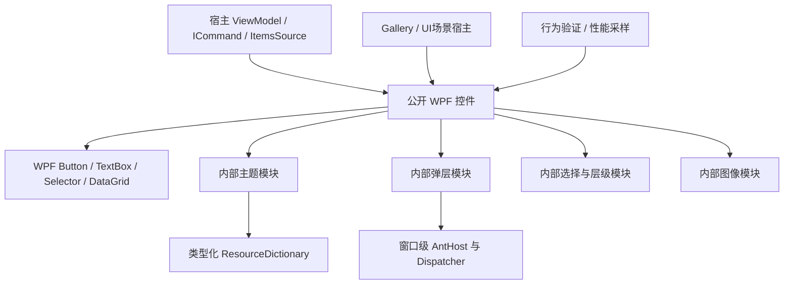

# Antd.Wpf 架构设计

状态：设计基线，2026-10-29；已开始M0控件库/Gallery/测试/真实包消费实现。目录仍包含后续目标，实际交付与未通过门槛见[实施状态](../implementation-status.md)。

## 1. 兼容、范围和决策优先级

- 保留 .NET Framework 4.8+；现代 .NET 最低提高为 .NET 8，核心包目标固定为 `net48;net8.0-windows`。不再支持 .NET 6/7。
- net481、net8、net9、net10 的消费兼容与实测状态分开记录；正式发布必须验证 net48、net481、net8、net10。未来版本须通过消费矩阵后列为实测支持。
- 核心面向 Windows WPF，默认不引入浏览器、MVVM 框架、DI 容器、数据库或网络数据访问层。
- 官网 6.6.8 的组件文档是功能参考；[组件规格](../components/README.md)是本项目实施契约。C#/WPF 的值语义、绑定、输入法和辅助功能优先，React 类型不是公开接口模板。
- 冲突时先满足正确性和可访问性，再满足本文件的资源/生命周期约束，再做视觉对齐。达不到性能门槛时缩小该功能支持范围并记录，不能声称性能已获保证。

## 2. 物理项目与依赖方向

首期只交付一个产品 NuGet，避免拆出很多只有转发作用的程序集。以下目录是创建项目时的目标结构，不表示当前均已存在。

```text
Antd.Wpf.sln
src/Antd.Wpf/                    net48;net8.0-windows，唯一产品包
  Controls/<Component>/          原生派生类、事件参数、值类型
  Themes/Generic.xaml            默认样式入口
  Themes/Controls/<Component>.xaml
  Themes/Tokens/                 Light/Dark/Compact资源
  Internal/Theming/              token派生、作用域与资源桥接
  Internal/Overlay/              定位、焦点、关闭与窗口协调
  Internal/Selection/            实际共享的key/勾选/层级状态逻辑
  Internal/Imaging/              按需解码、资源生命周期
  Automation/                    新增交互控件的AutomationPeer
  Icons/                         构建时已校验的矢量资源
samples/Antd.Wpf.Gallery/        net48;net8.0-windows，功能样例
tests/Antd.Wpf.Tests/            纯逻辑与STA行为验证
tests/Antd.Wpf.UiTests/          Windows UI驱动，启动各版本宿主
tests/Consumers/                发布包消费矩阵
benchmarks/Antd.Wpf.Performance/ UI场景驱动与结果输出，按M0建立
docs/components/                每组件实现规格
docs/architecture/              本文件与性能契约
docs/engineering/               项目格式、skills与验证规范
```



依赖单向：产品不引用 Gallery、测试或基准；内部模块不反向依赖某个业务组件。公开控件继续继承适合的原生类，不通过统一 `AntControlBase` 抹去 Button/TextBox/Selector 的差异。先在真实重复出现后提取内部逻辑，不能为每个控件创建同名服务/工厂/接口三件套。

只有出现独立消费者或明显包体成本时才拆 Icons/Pro 等包。核心的单程序集设计不要求把所有图标、所有主题预计算结果或所有页面一次实例化。

## 3. 公共接口规则

| 方面 | 约定 |
| --- | --- |
| XAML命名 | `AntButton` 等类型，命名空间 `Antd.Wpf.Controls`；库发布时映射稳定的XML命名空间 |
| 属性 | 显示/交互状态用DependencyProperty；不暴露内部服务、容器缓存和内部视觉树；允许显式传入定位目标，卸载后释放库持有的引用 |
| 数据 | ItemsSource、SelectedItem/Value/Keys、DataTemplate、ItemContainerStyle按原生模式扩展；集合必须按实例创建 |
| 命令 | ICommand与CommandParameter；回调不替代已有原生命令语义 |
| 事件 | 有意义的用户意图和状态变化；程序设置与用户操作是否触发必须逐项规定 |
| 绑定 | 可编辑值提供明确TwoWay元数据与更新时机；内部使用SetCurrentValue等保留外部Binding的方法 |
| 值模型 | 核心跨目标用DateTime?/TimeSpan?/decimal?；Key稳定且与可见索引分开 |
| 模板 | 必需PART名称、可选PART缺失时行为、VisualState名称随组件公开并测试 |
| 异常 | 非法域编程参数验证拒绝；集合变化导致的索引失效按约定Coerce/钳制；输入中间态用校验状态呈现；异步失败返回可处理结果 |
| 线程 | UI接口归创建该控件的Dispatcher；纯计算可脱离UI线程；跨线程调用约定显式 |
| 跨目标差异 | 公共签名和可观察结果一致；现代运行时优化优先局部实现，不污染共享契约 |

CLR包装器只调用GetValue/SetValue，实际副作用放在DP回调，保证XAML与Binding路径相同。DP注册元数据中的AffectsMeasure仅用于真正改变期望尺寸的属性；颜色、Hover和纯绘制状态不触发布局。

绑定的默认值、状态优先级、空值、取消、重入、重模板化、卸载后再次加载都是接口的一部分，不能只写属性表。

## 4. 主题模块：一次解析、局部失效

**小接口**：应用或窗口设置主题/语言/尺寸；组件通过稳定类型资源键消费；宿主可覆盖资源。主题模块负责派生、缓存与作用域，不让每个控件重复解析颜色。

1. 种子值 → 调色板/尺寸 → 语义token → 组件token → 类型化资源。核心输出Color、Brush、CornerRadius、Thickness、Duration，不在每次渲染解析字符串。
2. 一个有效主题作用域拥有一个快照与资源字典；同一快照中的可冻结对象复用。可变Brush不得跨作用域共享后再原地变色。
3. 用户覆盖 > 局部作用域 > 窗口 > 应用 > 默认资源；主题切换只替换库拥有的字典。新资源在替换前完整生成，避免部分组件读到新旧混合值。
4. 可变主题token通过DynamicResource；固定几何和模板结构使用StaticResource。模板从首次使用按需展开；Generic.xaml只持有资源定义，不构造隐藏控件。
5. Popup显式获得来源作用域；切换主题不能重新创建输入TextBox、清空选区或改变ItemsSource。
6. 有上限的主题快照缓存只保存纯数据/冻结资源，不保存Window、Dispatcher或控件；动态主题不靠全局静态事件通知所有控件。
7. 本地尺寸与最小可访问尺寸分开：24/32/40 DIP是参考高度，放大字体和多行内容应能扩展。

派生算法只在种子改变时执行。窗口移动、滚动或Hover不生成主题字典。调色板移植须锁上游版本并验证对照值，Dark不是Light取反。

## 5. 弹层模块：窗口所有权明确

**小接口**：每个窗口一个AntHost；在指定Owner下呈现提示、确认和抽屉；调用者只关心结果、取消与关闭。内部协调焦点、定位、层级和清理。

| 类型 | 承载 | 责任 |
| --- | --- | --- |
| Tooltip/Popover/Select菜单 | ToolTip或Popup | PlacementTarget、屏幕边缘、DPI、关闭原因、主题/DataContext桥接 |
| Modal/Drawer | AntHost窗口内遮罩 | 遮罩点击、背景交互、焦点限制、Esc、关闭顺序、异步确认 |
| Message/Notification | AntHost反馈队列 | key更新、队列上限、计时暂停/关闭、多窗口隔离 |

Modal的建议调用面为 `ShowAsync(owner, options, cancellationToken)` 返回明确结果；确认逻辑可采用返回Task的显式委托。名称与类型在M0冻结；核心接口不要求新DI容器。显示和关闭均归Owner Dispatcher，Owner销毁后等待必须完成或取消。

原生Popup是独立HWND。打开窗口内Modal前关闭/协调旧Popup，不能用一个整数z-index假装所有层都在同一视觉树。HwndHost/WindowsFormsHost的airspace场景另作owned Window技术验证；失败时明确支持边界。

弹层具有Opening/Open/Closing/Closed状态。一次关闭只完成一次结果；调用取消、用户关闭与Owner销毁可竞争，但最终资源清理幂等。异步确认期间防重入；失败保留有效对话框，关闭后到达的回调不得复活窗口。

## 6. 选择、数据和大规模内容

- 原生Selector/TreeView/DataGrid满足的行为直接保留。内部共享逻辑仅处理多个实际控件都需要的稳定Key、Checked/Selected/Expanded分离、层级关系；不创建通用ORM或万能数据模型。
- Key是实体身份，索引是当前呈现位置，排序/过滤/分页后不可混用。多选保存Key集合；回收容器只映射状态，不能拥有持久选择状态。
- 数据视图默认每个控件独立，只有显式传入同一ICollectionView才共享排序/筛选；批量更改用DeferRefresh，避免一次字段修改触发多次全表处理。
- 远程查询归宿主VM/Command。控件发搜索/翻页意图，展示ItemsSource/IsLoading/Error；请求序号、取消token、快照版本阻止旧结果覆盖新结果。是否加异步提供器应由真实宿主需求决定。
- 常规平面列表用原生回收虚拟化；必须有有限视口，不能额外用外层ScrollViewer把全部数据Measure出来。
- P2的AntTree继承原生TreeView，面向小/中规模基础树；P3新增独立AntVirtualTree，采用“展开节点的扁平投影 + 虚拟列表”，不改变已发布AntTree基类/模板契约。两者共享Key与内部状态语义；大型TreeSelect从一开始采用外层Control契约，后续在内部接入同一扁平投影。
- 大树索引只处理可见投影变化，选择与勾选仍按稳定节点Key保存；不得把普通ItemsControl或原生TreeView的外观换肤当成已完成十万节点性能实现。
- 原生DataGrid路线先保障行/列虚拟化、平面排序筛选编辑、左固定列。右固定、树表、跨行跨列合并、嵌套表、拖拽与虚拟化组合逐项通过技术验证后才开放。

数据虚拟化/分页与UI虚拟化分别验收。控件不会为了“全选”自动向服务器拉取全部数据，跨页全选必须由宿主定义语义。

## 7. 图像、动效和资源

- Image/Avatar请求由Owner管理，解码尺寸匹配目标DIP与DPI；更换Source或卸载取消旧操作；缓存按解码内存计费并有淘汰策略。
- BitmapImage在完成OnLoad解码后关闭源流；可冻结结果再交给UI线程。用户传入的ImageSource由用户拥有，控件不得擅自Dispose其底层资源。
- 使用Storyboard/RenderTransform/Opacity实现合适动效；不要每帧改Margin/Width迫使布局。关闭动画是所有动效模块的正常路径。
- 连续动画在不可见、窗口最小化和卸载时暂停/结束；计时器按宿主/任务共享实际必要的调度，不能每个Skeleton条目各建一个全局Rendering订阅。
- 矢量在构建时准备Geometry/Drawing；按实际图标加载。自定义模板、Effect与高分辨率图片可显著改变成本，性能承诺只适用于记录的模板场景。

## 8. 生命周期、异常与扩展限制

每个组件需要一张资源所有权表：订阅/Timer/Popup/CancellationTokenSource/异步任务由谁创建、何时解绑/取消/关闭。OnApplyTemplate应先解绑旧PART；Unloaded后可能再次Loaded，不能把第一次卸载当永久Dispose，也不能留下上一轮请求。

窗口级状态由窗口拥有。全局注册只持有纯资源或弱所有权关联；最终实现必须验证Owner关闭可回收。WeakEventManager只用于适合的长生命周期源，不拿弱引用掩盖遗漏的关闭路径。

公共控件保留可重新模板化能力；内部不为未来假设增加插件系统、反射扫描、热路径表达式编译、全局消息总线。真正需要变化的接口放在宿主命令、模板或Owner等实际接缝上。

## 9. M0 技术验证与架构门槛

1. 用同一份源码构建两目标，从打包产物消费，而不只是ProjectReference编译。
2. 同时展示Button/Input/单选Popup；切换主题后输入选区、绑定与焦点保留，模板重新应用不重复响应。
3. 两个窗口主题不同；一个窗口关闭后另一窗口提示与异步确认正常，关闭窗口可回收。
4. 默认模板下1万条列表/表格只实现视口附近容器，容器数量不随源总量线性增长。
5. 记录首屏、输入响应、主题切换、滚动、分配与清理的机器基线，执行[性能契约](performance.md)。
6. 只有上述完成才冻结公开主题、弹层与选中Key契约；复杂表格技术验证未通过时，调整能力范围而非隐式关闭虚拟化。

## 10. 设计依据

- [WPF控件编写](https://learn.microsoft.com/en-us/dotnet/desktop/wpf/controls/control-authoring-overview)：原生内容、模板与扩展模型。
- [控件性能](https://learn.microsoft.com/en-us/dotnet/desktop/wpf/advanced/optimizing-performance-controls)：虚拟化与回收约束。
- [布局性能](https://learn.microsoft.com/en-us/dotnet/desktop/wpf/advanced/optimizing-performance-layout-and-design)：Measure/Arrange与失效成本。
- [数据绑定性能](https://learn.microsoft.com/en-us/dotnet/desktop/wpf/advanced/optimizing-performance-data-binding)：通知、绑定与集合更新成本。
- [线程模型](https://learn.microsoft.com/en-us/dotnet/desktop/wpf/advanced/threading-model)：Dispatcher拥有权与短工作项。
- [主题token](https://ant.design/docs/react/customize-theme/)：上游主题结构。

这些原则用于约束实现，不能替代后续真实WPF的性能测量。
